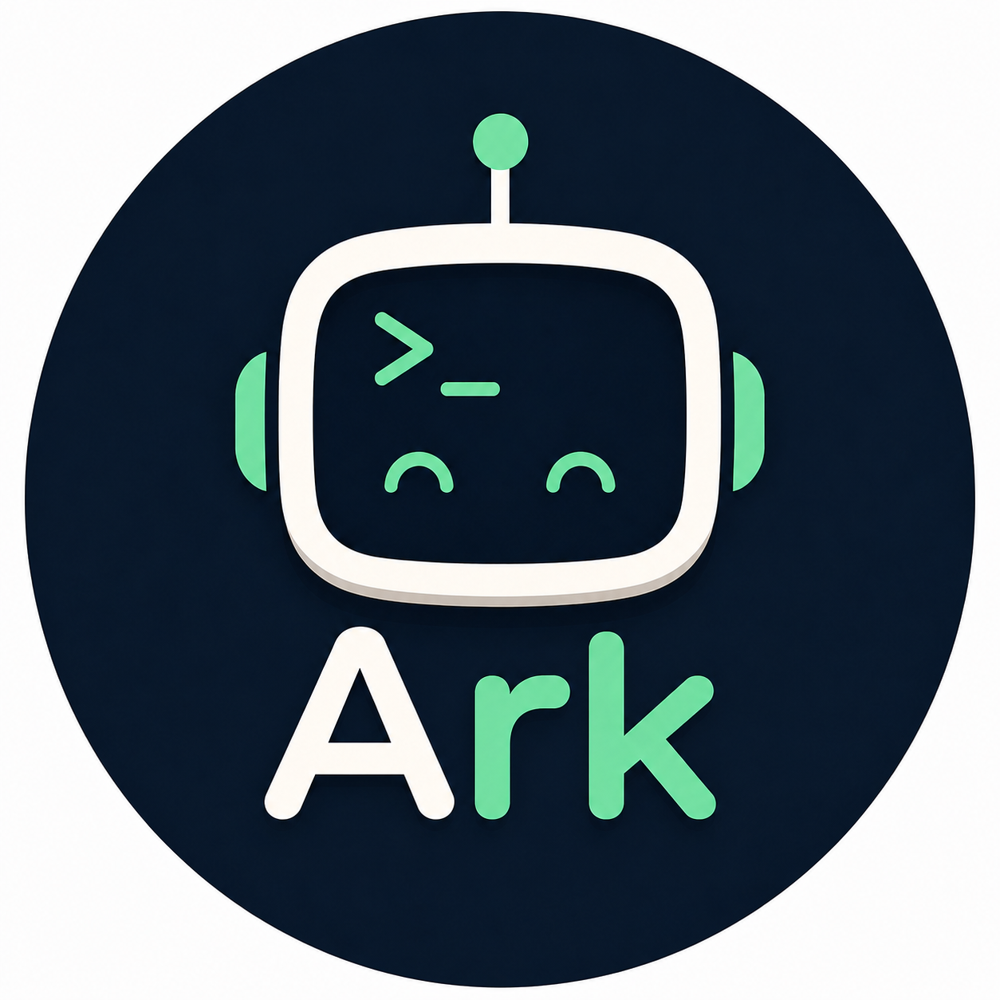

# Ark

<p align="center">
  
</p>

Ark is a small, didactic coding agent for studying how language models inspect code, propose changes, and validate them with tests. It is an ongoing research project developed by [ASERG](https://aserg.labsoft.dcc.ufmg.br/) at DCC/UFMG. See the [paper](https://arxiv.org/abs/2608.10934) for additional context.

## 1. Goal

Ark makes the core mechanics of a coding agent easy to inspect and experiment with. Its focus is not feature breadth, but a clear implementation of the agent loop:

1. Give a model a programming task and a local workspace.
2. Let it inspect files and run tests through a small set of constrained tools.
3. Ask for user approval before changing a file.
4. Run the tests before accepting the result.
5. Record the complete interaction in a readable trace.

Ark is intended for research, teaching, and small curated benchmarks. It is not a general-purpose autonomous development environment or an operating-system security sandbox.

## 2. Running Ark

### Requirements

- Python 3.11 or newer.
- An OpenAI API key or an OpenAI-compatible endpoint.
- A task workspace containing a `prompt.txt` file, source code, and Pytest or Maven tests.
- For Maven tasks: a compatible JDK and the project's executable `mvnw`, `pom.xml`, and `.mvn/` files. The `./mvnw` runner requires a POSIX shell, such as on macOS or Linux.

### Installation

From the project root:

```bash
python3 -m venv .venv
source .venv/bin/activate
python -m pip install -r requirements.txt
```

Ark runs Pytest tasks with the same Python environment. Install any task-specific Python dependencies in this virtual environment as well.

### Included test workspaces

The repository includes a `test_workspace/` directory with small, ready-to-run examples covering bug fixes, feature implementation, and refactoring. Each subdirectory is an independent task with its own prompt, source code, and tests.

For example:

```bash
python run_ark.py ./test_workspace/bugfix_001_date_range
```

Ark copies the selected example to `ark-workspace`, so the original files under `test_workspace/` remain unchanged and can be reused in later runs.

### Model configuration

Ark uses the OpenAI Python client. The default `config/config.json` is:

```json
{
  "openai_base_url": null,
  "openai_model": "gpt-6-luna",
  "timeout_seconds": 600,
  "openai_api_key_env": "OPENAI_API_KEY",
  "test_runner": "pytest",
  "max_iterations": 20
}
```

`openai_model` selects the model, `timeout_seconds` limits each request, and `openai_api_key_env` names the environment variable containing the API key. A null `openai_base_url` uses the default OpenAI endpoint.

Export the configured key and pass a task workspace to Ark:

```bash
export OPENAI_API_KEY="your_key_here"
python run_ark.py ./test_workspace/bugfix_001_date_range
```

To use an OpenAI-compatible endpoint, set `openai_base_url` and choose the corresponding `openai_model`. Ark supports only the OpenAI client protocol; there is no backend selector in the configuration.

### During a run

Ark copies the supplied task into `ark-workspace` and works only on that copy. Whenever the model proposes an edit, Ark prints a unified diff and asks:

```text
Authorize edit? [y/N]:
```

Only `y` or `yes` applies the change. When the run succeeds, the final files remain in `ark-workspace`; the original task directory is never modified. The full execution trace is written to `agent_trace.log`.

### Task workspace format

A task directory should look like this:

```text
my-task/
├── prompt.txt
├── src/
│   └── ...
└── tests/
    └── ...
```

- `prompt.txt` contains the task given to the model.
- Source and test files are available to the agent inside the copied workspace.
- `AGENTS.md` is optional and adds task-specific instructions to the prompt.
- `evaluation/` is intentionally excluded from the runtime copy, so private evaluation tests are not visible to the agent.

### Test runners and timeouts

Tests always run from the copied workspace root. Pytest is the default. Select Maven explicitly for a Java task:

```bash
python run_ark.py ./python-task --test-runner pytest
python run_ark.py ./java-task --test-runner maven
python run_ark.py ./java-task --test-runner maven --test-timeout 600
```

| Runner | Fixed command | Default timeout per test run |
| --- | --- | --- |
| `pytest` | `python -m pytest -q -p no:cacheprovider` using Ark's Python interpreter | 30 seconds |
| `maven` | `./mvnw test` | 300 seconds |

`--test-timeout` must be a positive integer in seconds. Both the `run_tests` action and the final tests requested by `finish` use the selected runner and timeout.

You can set `test_runner` in `config/config.json` and optionally add `test_timeout_seconds`, for example:

```json
"test_runner": "maven",
"test_timeout_seconds": 180
```

Runner selection follows: command-line flag, then configuration, then `pytest`. Timeout selection follows: command-line flag, then `test_timeout_seconds`, then the default for the selected runner. Omit `test_timeout_seconds` to retain the separate Pytest and Maven defaults. The existing `timeout_seconds` setting only controls model requests.

Ark reports a missing or non-executable Maven wrapper without falling back to Pytest. Make `mvnw` executable in the original task directory before running Ark; the workspace copy preserves its permissions. The [Maven Wrapper](https://maven.apache.org/tools/wrapper/) may download Maven on its first invocation, and the build may download dependencies; this time counts toward the test timeout.

A timeout is reported as a test failure with the available partial output. On macOS and Linux, Ark stops the test process group, including test subprocesses. A timed-out `finish` leaves the edits in place so the agent can continue. Searches skip Maven's generated `target/` directories.

### Iteration limit

Ark allows 20 model-requested actions per run by default. Set `max_iterations` in `config/config.json`, or override it for a run:

```bash
python run_ark.py ./java-task --test-runner maven --max-iterations 40
```

The limit must be a positive integer. The flag takes precedence over configuration; configurations without this field still default to 20. Reaching the limit stops the agent and rolls back approved edits.

## 3. Architecture

At a high level, one run follows this flow:

```text
task workspace
      |
      v
copy to ark-workspace
      |
      v
model response -> parse one tool call -> execute tool -> store observation
      ^                                              |
      |______________________________________________|
      |
      v
finish -> run tests -> keep changes or continue/rollback
```

The main modules are deliberately small and have distinct responsibilities:

- `inputs.py` loads configuration and prompts, prepares `ark-workspace`, and creates the execution `Context`.
- `agentic_loop.py` coordinates model calls, tool execution, completion with final tests, and rollback.
- `models.py` defines `Model`, which owns the model configuration and system prompt, reuses one OpenAI client throughout the run, sends requests, and normalizes responses and token usage.
- `protocol.py` parses and validates the model's requested action.
- `tools.py` implements workspace inspection, test execution, and approved edits.
- `memory.py` defines `Memory`, stored in `Context`, which builds the compact history sent with the next model request.
- `traces.py` records the execution in `agent_trace.log`.

## Agent loop

The model returns exactly one action per iteration:

```text
Thought: brief reasoning
Action: tool_name
Action Input: tool-specific input
```

Ark executes the action, adds its result to memory as an observation, and calls the model again. If the response does not follow the protocol, Ark makes one repair request.

The available actions are:

| Action | Input | Purpose |
| --- | --- | --- |
| `list_files` | Relative directory, or blank for `.` | List recursive paths relative to the workspace root. |
| `read_file` | File path, optionally followed by `\| start:end` | Read numbered UTF-8 lines; ranges are inclusive and start at 1. |
| `find_text` | `search text \| directory` | Search files below a directory. |
| `run_tests` | Blank | Run the selected fixed Pytest or Maven command. |
| `edit_file` | `path`, `old`, and `new` blocks | Propose one exact replacement. |
| `finish` | Blank | Request final validation. |

All tool paths are restricted to `ark-workspace`. Recursive listings omit `.git`, `.venv`, `__pycache__`, and `target`, do not descend into directory symlinks, and omit symlinks pointing outside the workspace. Listings stop at 100 entries or the observation size limit and include an explicit truncation notice. List a relevant subdirectory or use `find_text` to narrow exploration.

`read_file` accepts a plain path or a range such as `src/test/java/StoreIntegrationTest.java | 70:110`. The output contains a workspace-relative path, the displayed line range, and numbered source lines. Line numbers are labels, not part of the source code used in edits. Long reads stay within the 8,000-character observation budget and include the next range to request. A single line too large to fit is reported explicitly rather than silently cut.

A repeated read of the same range is skipped while its current contents remain in context, including retained reads. Other ranges can be read immediately. Failed reads are not cached. An approved edit invalidates every earlier range for that file, including reads through equivalent relative or absolute paths. Re-reading is allowed when contents have been edited or evicted from context.

## Edits and approval

`edit_file` replaces one exact block in an existing file. For example:

````text
path: src/orders.py
old:
```python
def subtotal(items):
    return sum(item["unit_price"] * item["quantity"] for item in items)
```
new:
```python
def subtotal(items):
    return calculate_subtotal(items)
```
````

Before requesting approval, Ark checks that the path is inside the runtime workspace, the file exists, `old` occurs exactly once, and `new` is different. This version edits existing files only; it does not create or delete files.

The first approved edit creates a temporary snapshot. A successful `finish` keeps the runtime changes and discards the snapshot. Reaching the configured iteration limit (20 by default) or encountering an unexpected loop error restores the runtime workspace from that snapshot.

## Memory and trace

Each model request receives a compact summary rather than the entire raw conversation. Memory includes files already read, searches already made, whether tests have run, and the four most recent steps. Up to three additional successful read observations are retained so navigation does not immediately evict relevant code. Read observations are not duplicated, and file contents invalidated by an approved edit are not sent again. Each observation is limited to 8,000 characters, and large `edit_file` inputs are represented only by their target path.

`agent_trace.log` is cleared at the beginning of each run and records:

- The task prompt and parsed model actions.
- Edit validation, approval outcomes, and diffs.
- Test and finish results.
- Protocol validation and repair attempts.
- Errors, rollback events, elapsed time, token usage, and tool counts.
- A final run status: `success`, `max_iterations_reached`, or `failed`.

The trace is intended to make agent behavior reproducible and easy to analyze. It is excluded from Git.

## Limits

Ark constrains its own file paths and test commands, but task tests and Maven builds still execute as local processes. Run only trusted task workspaces. Ark is best suited to small tasks whose changes can be expressed as exact replacements in existing files.
